# Concord

**Live demo (public access): [https://coding-measures-colleagues-slot.trycloudflare.com/console](https://coding-measures-colleagues-slot.trycloudflare.com/console)**

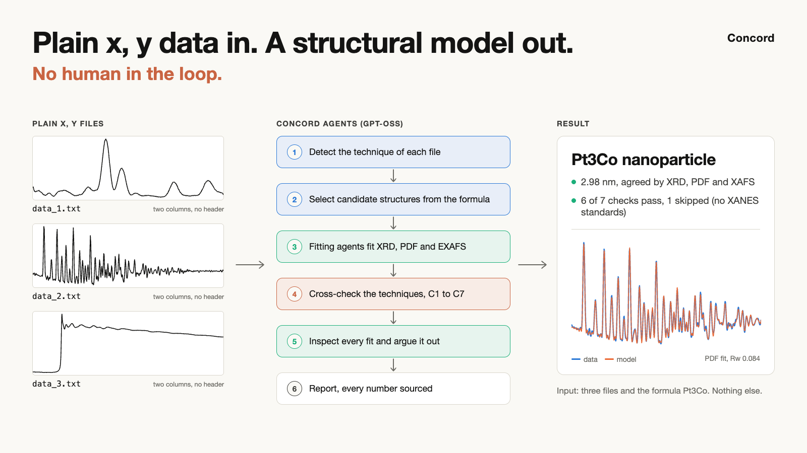

**3 techniques 1 solution without human intervention.**
**PDF-XRD-XAFS**

> [!IMPORTANT]
> **Works on real measured data, not only simulations: over 99.5 % agreement with the known structures.**
> On openly published experimental data (a lab XRD pattern, a synchrotron PDF and a synchrotron EXAFS spectrum),
> Concord picked the **right phase every time** (Pt3Co by XRD out of 5 candidates, fcc Pt by PDF out of 4), refined the
> Pt lattice to **3.933 Å against 3.924 Å (99.8 %)** and the Pt–Pt bond to **2.763 Å against 2.775 Å (99.6 %)**,
> in seconds, with no LLM and no person. Details: [It works on measured data too](#it-works-on-measured-data-too).
>
> | | Simulated (19 held-out samples) | Measured (open data) |
> |---|---|---|
> | Right phase | 100 % | 2 of 2 (XRD, PDF) |
> | Bond length / lattice | within 0.0033 Å (EXAFS), 0.0004 Å (PDF) | within 0.012 Å (EXAFS), 0.009 Å (PDF lattice) |
> | Fit quality | | PDF Rw 0.116, EXAFS R-factor 0.0041 |

Give Concord three plain two-column files and a formula. No headers, no technique labels, no structure files, no fit
settings. Concord works out what each file is, picks the candidate structures, lets one AI agent per technique drive
its fit, cross-checks the techniques, has a critic agent challenge the result and writes the report. **No person
touches it between upload and report.**

Each technique sees a different part of the structure: XRD the long-range order, the PDF the local and intermediate
order, EXAFS the neighbours of one element, XANES its oxidation state. Concord fits all of them with deterministic,
tested code and then checks them against each other (C1–C7). LLM agents choose the fit settings and argue over the
result, but **numbers decide and the LLM explains**: every number comes from a tool or a cited source, and
disagreements are settled by re-running tools, never by the model.

Concord is a fork of [CrystaLenz](https://github.com/MJRaei/CrystaLenz) (MIT), an agentic XRD analysis tool. The realism GANs come from the companion repository
[Concord Forge (GAN-Hackathon)](https://github.com/sarthak-1111/GAN-Hackathon).

Contents: [What it does without a person](#what-it-does-without-a-person) ·
[How well it works](#how-well-it-works) · [Run it](#run-it) · [GAN models](#gan-models-concord-forge) ·
[Prior work and credits](#prior-work-and-credits) · [Limits](#limits)

## What it does without a person

The run shown here used the XRD, PDF and XAFS data of the Pt3Co sample s0019 with every header removed (files
`data_1.txt`, `data_2.txt`, `data_3.txt`) and the formula Pt3Co. Every number in this section was read from that run's
output files.

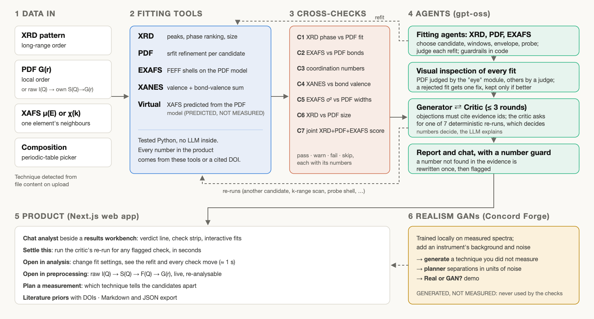

*Figure 1. What runs. Tested tools (blue) compute every number; the LLM agents (green) choose the fit settings, judge
each refit and argue over the result; every challenge is settled by re-running a tool.*

1. **Read the files.** Concord recognised each file from its numbers alone: an XRD pattern in 2θ, a PDF G(r) and an
   XAFS μ(E) scan, all with high confidence, and found the Pt L3 edge from the energy range (Figure 2). Instrument
   values missing from the files (X-ray wavelength, Qmax, Qdamp, S0²) were assumed and listed on the result.

   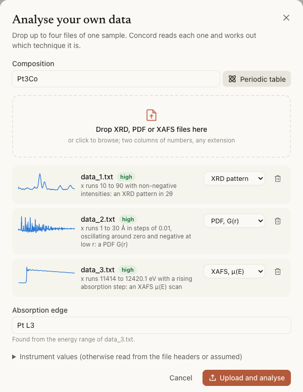

   *Figure 2. The upload. Three unlabelled files; the technique, its evidence and the absorption edge are all
   inferred.*

2. **Choose the structures.** From the formula Pt3Co, Concord took every library structure sharing a metal with it,
   5 in all (Pt3Co, PtNi, Pt, PtO2, Co3O4), and fitted each against the XRD and the PDF. Pt3Co won both: XRD score
   0.947 against 0.644 for the runner-up, PDF Rw 0.091 against 0.116 (Figure 3).

   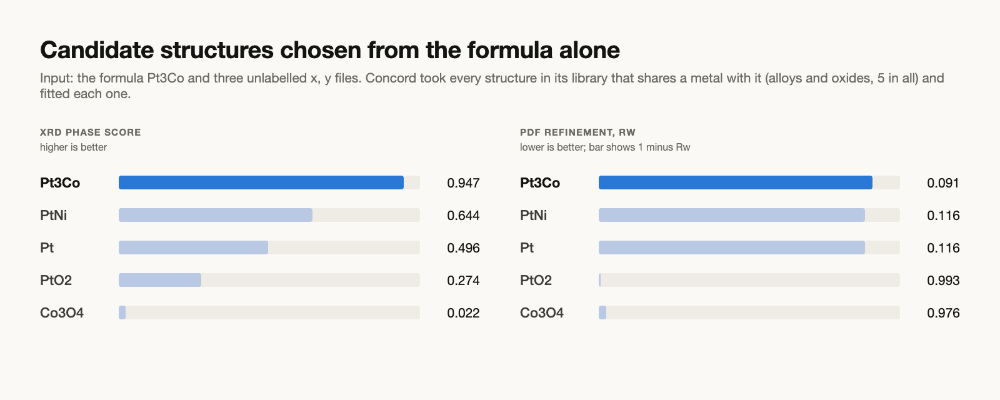

   *Figure 3. Candidate structures picked from the formula alone and ranked by the fits. Nobody named a structure.*

3. **Fit, by agents.** One LLM fitting agent per technique drives its own fit. It chooses what to try (the data
   window, the nanoparticle envelope, a light-neighbour probe shell, the peak thresholds); a tested tool does every
   refit, and a change is kept only if the fit improves enough and every value stays physical. The PDF agent runs a
   fixed ladder of refinement stages, each kept only if Rw improves by at least 1 %; the EXAFS agent keeps a shell the
   model lacks only when its N is above twice its uncertainty and an F-test agrees; XRD and EXAFS refits need a 2 %
   gain. On this run (made just before those rules were integrated, with a 2 % gain for every agent) the PDF agent cut
   the r-range to 20 Å, lowering Rw from 0.091 to 0.084. The EXAFS agent switched on a light-neighbour probe shell
   with kmax 10 Å⁻¹, lowering the R-factor from 0.0033 to 0.0028; its next request, which would have shrunk the
   k-window too far, was refused by the guard. The XRD agent tried three peak thresholds, none helped, so it kept the
   defaults (Figure 4). The settings the agents keep re-run the whole analysis.

   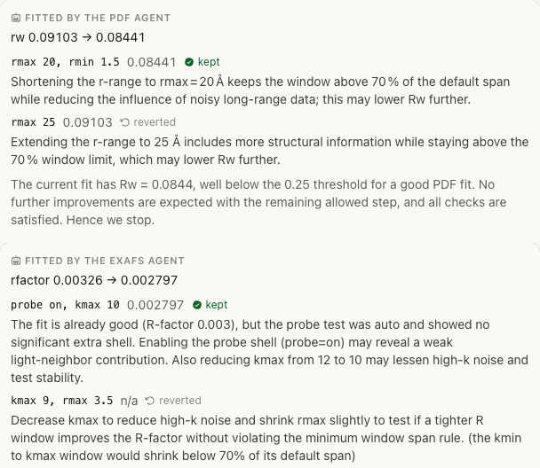

   *Figure 4. What the fitting agents did, as the product shows it: each refit with its metric, kept or reverted, and
   the agent's own reason. Top: the PDF agent. Bottom: the EXAFS agent.*

4. **Cross-check.** Seven checks compare the techniques: phase, bond lengths, coordination numbers, oxidation state,
   disorder, size and a joint score. With the tools alone, 5 checks passed and the coordination-number check (C3)
   warned. With the fitting agents' settings, 6 pass, C3 included; the oxidation-state check (C4) is skipped because
   no XANES reference standards were given. The verdict: consistent, Pt3Co, about 2.98 nm, agreed by XRD, PDF and
   XAFS (Figure 5).

   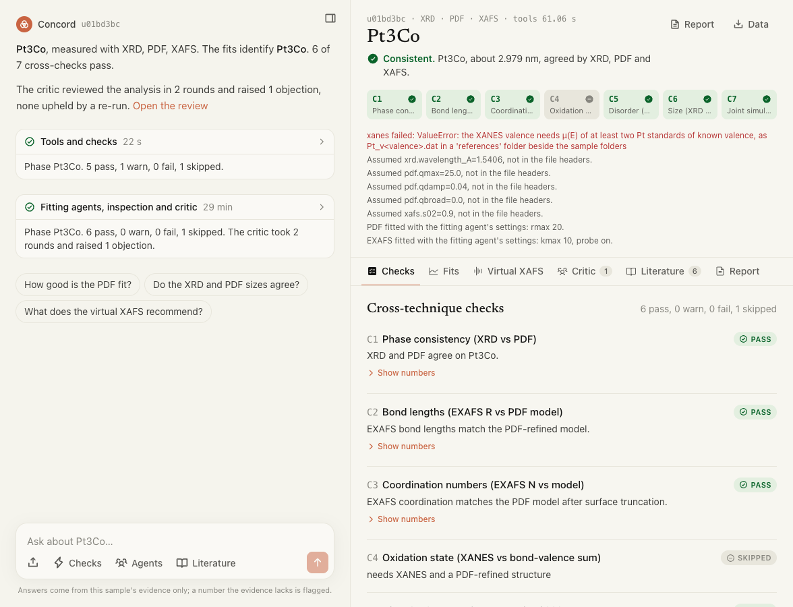

   *Figure 5. The result. Left, the analyst's chat: the tools-only run (5 pass, 1 warn) and the agent run (6 pass,
   0 warn). Right, the verdict, the check strip and every value Concord had to assume because the files carried no
   headers.*

5. **Argue and report.** A generator agent wrote the model as claims, each citing the evidence ids it rests on. A
   critic agent reviewed it over 2 rounds and raised 1 objection: "all checks pass" overstates, since C4 was skipped
   rather than passed (Figure 6). A number guard checked the prose: no number in it was missing from the evidence.
   The whole agent run took 29 minutes and 20 LLM calls, most of it waiting on the model.

   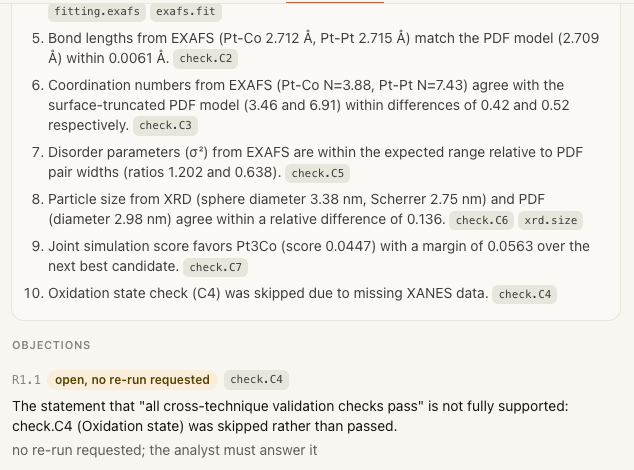

   *Figure 6. The critic's review: the generator's claims with their evidence ids, and the critic's objection on C4,
   left for the analyst to answer because no re-run can settle it.*

### The pipeline in detail

```
sample folder ─► XRD   peaks, phase ranking, Scherrer/WH size (Voigt, instrument-corrected)
               ► PDF   srfit refinement of every candidate: staged ladder, lattice, U_iso, size
               ► EXAFS first-shell fit on FEFF paths of the PDF model (+ probe shells)
               ► XANES valence (standards), bond-valence sum of the refined structure
               ► virtual EXAFS from the PDF model (PREDICTED, NOT MEASURED)
               ► checks C1–C7
               ─► fitting agents: XRD, PDF, EXAFS (refit, keep or revert, re-run the analysis)
               ─► visual inspection of each fit ─► generator ⇄ critic (≤ 3 rounds) ─► report
```

| Check | Compares |
|---|---|
| C1 | XRD phase ranking vs PDF refinement; lattice drift from the database value |
| C2 | EXAFS bond lengths vs the PDF-refined model |
| C3 | EXAFS coordination numbers vs the model (with surface truncation); shells the model lacks |
| C4 | XANES valence vs the bond-valence sum; mixed valence when both move away from the formal value |
| C5 | EXAFS σ² vs PDF pair widths (correlated vs uncorrelated motion, explained rather than flagged) |
| C6 | XRD vs PDF size (volume- vs number-weighted, multi-domain particles) |
| C7 | Joint score of each candidate: simulated XRD, PDF and EXAFS together |

- **Fitting agents.** One gpt-oss agent per technique drives its fit (`concord/agents/fitter.py`). Each turn it tries
  at most two new settings (XRD 2θ window, baseline stiffness, peak thresholds; PDF candidate phase, r window,
  nanoparticle envelope; EXAFS k window, R max, k-weight, light-neighbour probe shell) or accepts. A tested,
  deterministic refit computes every number. Guardrails in code: values clipped to their ranges, at most 3 refits per
  technique, no data window below 70 % of its default span, PDF lattice drift at most 3 %, Qdamp never fitted. XRD and
  EXAFS refits are kept only if their metric (XRD score, EXAFS R-factor) improves by at least 2 %.
  - The **PDF fitting agent** refines in a staged ladder (scale and lattice, U_iso, particle size, δ2, consolidate)
    with physical bounds; a stage is kept only if Rw improves by at least 1 %, otherwise reverted.
  - The **EXAFS minor-shell rules** keep a light shell only when N > 2σ and an F-test gives p < 0.05.

  The kept settings re-run the whole analysis before visual inspection; the steps are shown under each fit plot.
- **Generator–critic loop.** The critic has its own prompt, high thinking and only the evidence. Every objection
  must cite evidence ids; it can ask for one of seven re-runs (another PDF candidate, envelope on/off, a probe shell,
  a k-range scan, size from the strongest peak, a second XRD phase, a zoomed visual inspection), and the re-run
  decides. A re-run that cannot run leaves the objection unsettled. A number guard rejects any number in the prose
  that is not in the evidence.
- **Visual inspection.** Fit plots are rendered deterministically (XRD with reflection ticks, PDF, EXAFS in k and R,
  and a zoom on the largest misfit). PDF fits are judged by the eye module when `EYE_MODULE_PATH` is set (below);
  XRD and EXAFS fits, and PDF without it, by an open fallback (residual features calibrated on the development split
  + gpt-oss judge). A fit is accepted only if the visual and the numerical and physicality criteria all pass. A
  rejected fit gets one fix from a fixed menu (second XRD phase, PDF envelope on/off, EXAFS O shell); the fix is kept
  only if its re-run confirms it and the verdict does not get worse, otherwise it is reverted (at most 3 iterations).
- **Virtual XAFS.** When XAFS is missing, an ensemble of PDF-equivalent models (lattice, displacement, size and
  equally good candidates) is run through FEFF; the spread is shown as a band, labelled PREDICTED, NOT MEASURED,
  with a measurement recommendation. When XAFS was measured, the prediction is a consistency check.
- **Literature priors.** OpenAlex, Crossref and arXiv abstracts, local embeddings and FAISS; values are read with
  fixed patterns and kept with their DOI and sentence. They are context for the critic and the report, never fit
  constraints for this sample.

### The eye module

Set `EYE_MODULE_PATH` in `.env` to the eye module. It is loaded at run time through `concord/vision/eye_adapter.py`
and never vendored into this repository. The eye is a separate, private residual reviewer: it reads a PDF difference curve zone by zone and names the cause (lattice
drift, scale, envelope, correlated motion, wrong phase). On the development split it rejected 2 of 44 clean PDF fits
and 20 of 37 faulty ones. An image-judging module with an `inspect(image, context)` entry point also works. Without
the eye, the open fallback judges every fit; everything else is the same.

## How well it works

On a held-out set of 19 simulated samples (10 clean, 9 with planted faults), with thresholds fixed in advance, Concord
identified the phase every time, found 67 % of the planted faults with no false alarms, and put no number in the
agents' prose that was not in the evidence (Figure 7). Bond lengths came within 0.0033 Å (EXAFS) and 0.0004 Å (PDF),
sizes within 9.9 % (XRD) and 3.9 % (PDF).

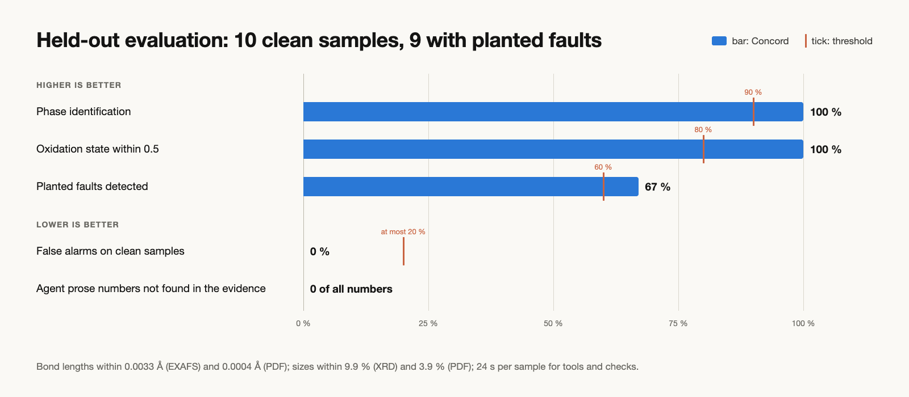

*Figure 7. Held-out evaluation. Bars are Concord, ticks the thresholds fixed before the evaluation.*

These held-out numbers predate the 2026-10-23 fitting-agent changes (the PDF refinement ladder and the EXAFS
minor-shell rules); the run used the earlier 2 % gate for every agent, PDF included. See
[`docs/PROGRESS.md`](docs/PROGRESS.md).

The table below is regenerated by `make eval` from `results/eval.json`.

<!-- results:start -->
`make eval` on dataset v1 (test, faults: 10 clean samples, 9 with planted faults), thresholds from `eval/config.yaml`. Overall: **pass**.

| metric | value | threshold | |
|---|---|---|---|
| Phase identification accuracy | 1 | ≥ 0.9 | pass |
| EXAFS bond length, mean abs. error (Å) | 0.00326 | ≤ 0.02 | pass |
| PDF bond length, mean abs. error (Å) | 0.000359 | ≤ 0.02 | pass |
| EXAFS coordination number, mean abs. error | 0.401 | ≤ 1.0 | pass |
| Oxidation state within 0.5 | 1 | ≥ 0.8 | pass |
| Size from XRD, mean rel. error | 0.0989 | ≤ 0.3 | pass |
| Size from PDF, mean rel. error | 0.0385 | ≤ 0.2 | pass |
| Planted faults detected (a check fails) | 0.667 | ≥ 0.6 | pass |
| False alarms on clean samples | 0 | ≤ 0.2 | pass |
| C1–C6 reported for every sample | 1 | ≥ 1.0 | pass |
| Runtime per sample, mean (s) | 24 | ≤ 120 | pass |
| Virtual EXAFS vs spectrum, median R-factor | 0.0219 | ≤ 0.1 | pass |

Virtual EXAFS against the hidden spectrum (XAFS withheld): median R-factor 0.011  
Faults that only raise a warning: 11% of fault samples.  
With the critic (`make eval-agents`, 19 of 19 runs complete): faults flagged by a check or a re-run-confirmed objection 67%, clean samples flagged 0%, numbers in the agents' prose not found in the evidence: 0, 26 min and 42k tokens per sample.  

Per-sample details: [`results/eval.md`](results/eval.md).
<!-- results:end -->

## It works on measured data too

The held-out evaluation above is simulated. The same tools, with no change and no LLM, were then run on openly
licensed **measured** data downloaded from public repositories, given only the data and the composition: the XRD and PDF
through `concord analyze <folder> --fast`, the EXAFS through `concord.analysis.run_exafs` with the fcc Pt model (the
command line fits EXAFS only after a PDF model). Seconds each.

| Technique | Measured sample (source, licence) | Concord found | Known answer |
|---|---|---|---|
| PDF | Colloidal Pt nanoparticles, DESY, Qmax 22 Å⁻¹ ([DeepStruc `JQ_S1.gr`](https://github.com/EmilSkaaning/DeepStruc), Apache-2.0) | Phase **Pt** (fcc) out of 4 candidates, Rw 0.116 (Pt3Co 0.125, PtNi 0.462, PtO2 0.955); a = **3.933 Å**; particle diameter **3.26 nm** | fcc Pt, a = 3.924 Å (+0.2 %); a few-nm particles |
| EXAFS | Pt metal foil, Pt L3, transmission, APS 13-ID-C ([XASLIB spectrum 152](https://xaslib.xrayabsorption.org/spectrum/152/), CC0-1.0) | Pt-Pt **R = 2.763 ± 0.002 Å**, N = 10.6 ± 0.6 at S0² fixed at 0.9 (N·S0² = 9.56), σ² 0.0044 Ų, R-factor **0.0041** | fcc Pt: R = 2.775 Å, N = 12 (the low N matches S0² being held at 0.9: 12 × 0.8 = 9.6) |
| XRD | Pt-Co on reduced graphene oxide fuel-cell catalyst, lab diffractometer with a Co anode ([Zenodo 10.5281/zenodo.17131699](https://doi.org/10.5281/zenodo.17131699), CC-BY-4.0; Buriánek, Bouzek, Paušová 2025) | Phase **Pt3Co** out of 5 candidates, score 0.94 (PtNi 0.665, Pt 0.513 with no reflection matched); 4 of 5 peaks indexed, the fifth a broad hump at 29.4° (likely the carbon support); sphere diameter **3.4 nm** (Scherrer 2.7 nm) | Pt-Co alloy nanoparticles on rGO (the record); the Pt3Co superlattice lines are barely visible, so the alloy is confirmed, its ordering is not |

<p>
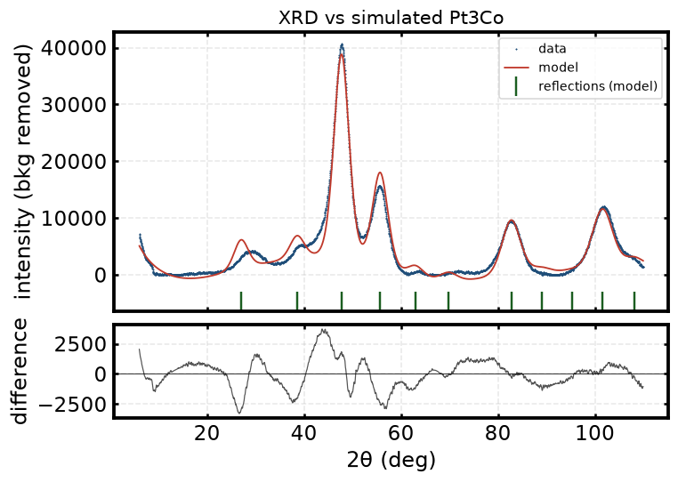
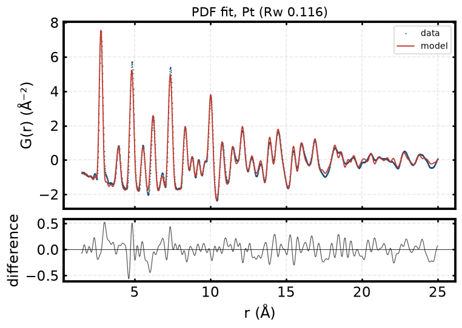
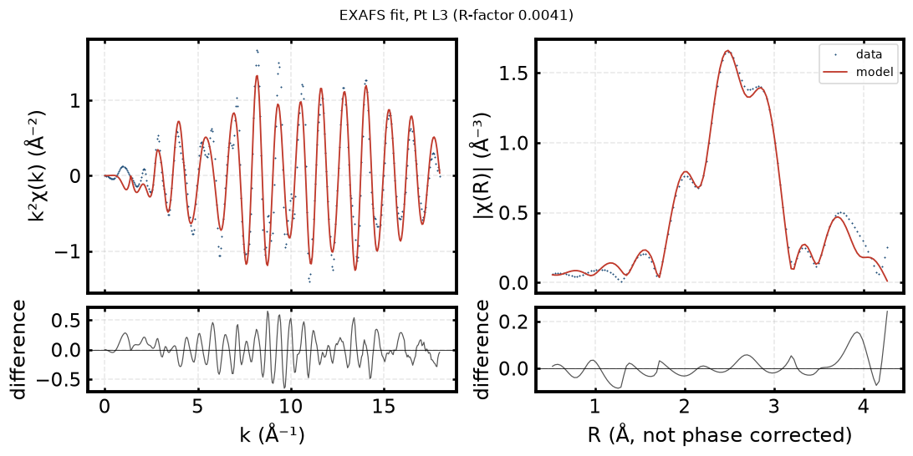
</p>

*Concord's own fit figures on the measured data: XRD of Pt-Co/rGO, PDF of Pt nanoparticles, EXAFS of a Pt foil.*

The numbers, sources and settings are in [`docs/experimental/`](docs/experimental/). Assumed values: the PDF file gives
no Qdamp, so the default 0.04 was used; the XRD has no instrument function, so its sizes are lower bounds.

## Run it

### Setup

```bash
make setup                     # uv sync + git hooks (Python 3.12, uv)
cp .env.example .env           # then fill in your own values (below)
make data                      # build dataset v1 (60 samples) from open structures, then validate it
```

Keys and paths go in `.env` (never commit it). The variables, from `.env.example`:

| Variable | Needed for |
|---|---|
| `LLM_BASE_URL`, `LLM_API_KEY`, `LLM_MODEL` | the agents (an Ollama-compatible endpoint serving gpt-oss); not needed for `--fast` runs |
| `MP_API_KEY` | optional: Materials Project structures as an extra data source |
| `EYE_MODULE_PATH` | optional: absolute path to the eye module (see [The eye module](#the-eye-module)) |
| `OPENALEX_API_KEY` | optional: free OpenAlex key for the paper miner; without one, OpenAlex allows about 100 searches a day per IP address, which the cache makes plenty |
| `GAN_REPO_PATH` | optional: absolute path to a clone of [GAN-Hackathon](https://github.com/sarthak-1111/GAN-Hackathon) (see [GAN models](#gan-models-concord-forge)) |

### Command line

```bash
uv run concord analyze dataset/samples/s0031 --fast   # tools + checks, no LLM, about 30 s
uv run concord analyze dataset/samples/s0031          # + fitting agents, visual inspection, critic loop (gpt-oss)
```

A sample folder holds any of `xrd.xy`, `pdf.gr`, `xafs_mu.dat` / `xafs_chi.k`, and either a `sample.json` or
`--composition Pt3Co`. Techniques are detected from the files present, instrument values from the file headers;
anything assumed is printed. Output: `results/runs/<sample>/report.md`, fit plots, `analysis.json`.

Other commands: `uv run concord priors Pt3Co` (literature values with DOIs), `make eval`, `make eval-agents`,
`uv run concord health` (LLM endpoint).

### Web UI

```bash
make api    # http://127.0.0.1:8000
make ui     # http://127.0.0.1:3000/console#s0031  (start make api first)
```

A conversation with the analyst beside a results workbench. The conversation opens with what the tools found (from
the data, no LLM), streams every run (tools, critic, literature search) as it happens, and answers questions about
the sample from its evidence only: each answer cites evidence ids that open the matching check, fit or panel, and
passes the number guard (a number the evidence lacks is flagged, never hidden). The workbench holds the cross-check
strip under a one-line verdict, interactive fit plots (drag to zoom, a readout of every curve) with the visual
verdicts, the virtual XAFS, the critic review, literature priors and the report, with Markdown and JSON export. Every
failing or warning check offers **Settle this**: one of the critic's deterministic re-runs (another PDF candidate, a
second XRD phase, an EXAFS k-range scan, a probe shell, envelope on or off, size from the strongest peak), and the
re-run's numbers decide. Numbers in the analyst's answers are linked to the evidence value they came from. Light and
dark themes; phone layouts switch between the two panes.

Under every fit plot, **Open in analysis** changes that fit's settings (XRD range, baseline and peak finding; PDF
candidate, r range, Qdamp, envelope; EXAFS k and R windows, k-weight, probe shell) and shows the refit and every
cross-check that would change, in about a second; **Keep and re-analyse** records the settings in the report, and
**Original** restores the analysis before them. For PDF, **Open in preprocessing** reduces the raw total scattering
step by step (raw and container, S(Q), F(Q), G(r)) with Concord's own code (`concord/tools/sq_to_gr.py`) and can
analyse the new G(r) as a new sample; raw I(Q) files can be uploaded directly. When a sample lacks a technique, the
conversation offers to generate it from the fitted model with the GAN's instrument realism, labelled GENERATED, NOT
MEASURED and never used by the checks. Compositions can be picked from a periodic table that marks the elements with
library structures.

**Your own data.** Press **Analyse your own data** in the sidebar (or the upload button in the composer), give the
composition and drop up to four files. Concord reads each one and works out from its content whether it is an XRD
pattern, a PDF, raw I(Q), μ(E) or χ(k), shows a preview and the reading it chose (changeable), and finds the
absorption edge from the energy range of a μ(E) scan. CSV files and files with a text header row are rewritten as
plain columns. The tools run at once and the critic is one click away. Without data: **Try an example** opens an
analysed sample, and **Plan a measurement** (below) tells you what to measure. Values missing from the file headers
are assumed and listed. For the XANES valence, put μ(E) of at least two standards of known valence as
`<El>_v<valence>.dat` in a `references/` folder beside the sample folders.

### Tests

```bash
make test          # uv run pytest -q
make eval          # held-out evaluation, deterministic tools; rewrites the results table above
make eval-agents   # adds visual inspection and the generator-critic loop (LLM, minutes per sample)
```

## GAN models (Concord Forge)

The realism GANs are trained in the companion repository
**[Concord Forge: github.com/sarthak-1111/GAN-Hackathon](https://github.com/sarthak-1111/GAN-Hackathon)**. The generator weights are bundled in this repository under `models/gan/`; the model code and the
training live in GAN-Hackathon. Set `GAN_REPO_PATH` to a clone of it. The weights are loaded at run time with
`torch.load(weights_only=True)`.

**Plan a measurement** takes a composition and a particle size, simulates XRD, PDF and EXAFS for every candidate
phase with Concord's own simulators, and ranks the techniques by how different the closest pair of candidates looks
(RMS difference of curves scaled to unit RMS). Everything is labelled SIMULATED, NOT MEASURED and is never analysed
as data. With **Instrument realism**, the GANs add the background, gain and noise a real instrument records, and each
pair is reported as a multiple of that noise: for Pt3Co at 3 nm, PDF keeps its closest pair 39 times above the noise
while XRD separates Pt from Pt3Co by less than twice the noise. **Real or GAN?** shows a measured spectrum next to its
simulation and the GAN's version of it, and asks which one was measured.

The GANs are used for the planner, generated techniques and the Real or GAN? demonstration only, never for any
analysis, check or metric. Their limits, from the repository's own test: a classifier tells GAN output from measured
data 66 % of the time for XRD (classical added noise: 81 %), but 95 % for PDF and 91 % for EXAFS, no better than
classical noise. EXAFS realism covers the Pt, Co, Ni, Fe and Cu edges only. Without the GANs the planner works with
clean simulations.

## Prior work and credits

- **CrystaLenz.** Concord is a fork of [CrystaLenz](https://github.com/MJRaei/CrystaLenz), an agentic XRD analysis
  tool (MIT, "Copyright (c) 2025 CrystaLens Contributors"); its licence and copyright notice are kept in `LICENSE`, the
  credit in `NOTICE`. Its ADK agent graph and XRD and research sub-agents are kept.
- **Libraries and data.** Listed in [`docs/PRIOR_WORK.md`](docs/PRIOR_WORK.md) §4. Structures come from open databases
  with their licences in `data/manifest.csv`; literature priors cite their DOI.

## Limits

- The held-out evaluation is simulated (open structures, FEFF, Debye-scattering and XRD simulation). Measured XRD, PDF and
  EXAFS of Pt and Pt-Co samples fit correctly ([It works on measured data too](#it-works-on-measured-data-too)); a measured
  sample with all three techniques is the next test, and will expose effects the dataset lacks (preferred
  orientation, multiple scattering beyond FEFF's paths, beam damage).
- The held-out numbers predate the 2026-10-23 fitting-agent changes (see [How well it works](#how-well-it-works)).
- Without reference standards the oxidation-state check (C4) is skipped, as in the s0019 run. XANES uses a simple
  edge model with valence standards; oxide valences carry systematic offsets up to about 0.5.
- A full agent run takes minutes, dominated by the LLM.
- Sub-monolayer oxide shells and dopants of a few percent sit at the detection limit of these techniques; the
  planted low-concentration dopant is not detected.
- Pt3Co and Pt are hard to tell apart by PDF alone for small particles; C7 and EXAFS help, not always.
- The number guard checks that every number in the prose is in the evidence, not that it is attached to the right
  quantity. On s0031 the analyst quoted the C5 ratio 0.276 next to the wrong PDF σ², and the critic let it pass.
- The critic picks the re-run itself. On s0024 it rightly objected that C7 passes, then asked for a PDF re-fit that
  does not test that, so the log marks the objection refuted.
- The eye judges PDF fits only; XRD and EXAFS use the open judge. Of the 19 saved critic runs in `results/runs/`,
  s0031 was re-run with the eye; the other 18 were made before it was connected, so their PDF verdicts come from the
  open judge.

## Licence

MIT (see `LICENSE`, `NOTICE`).
